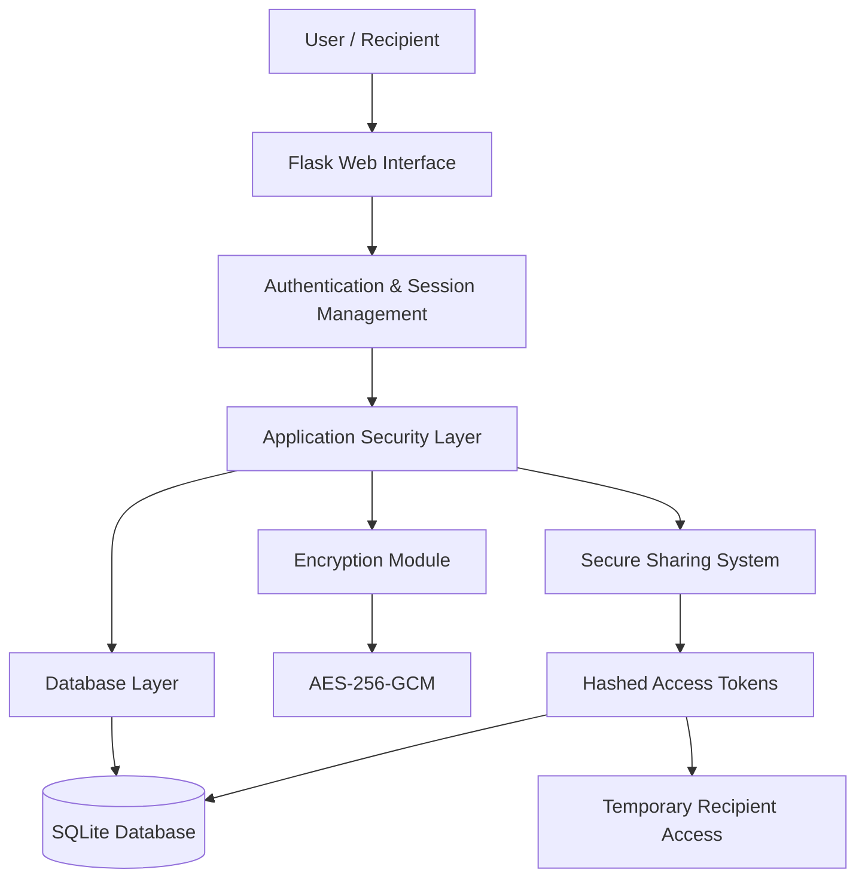
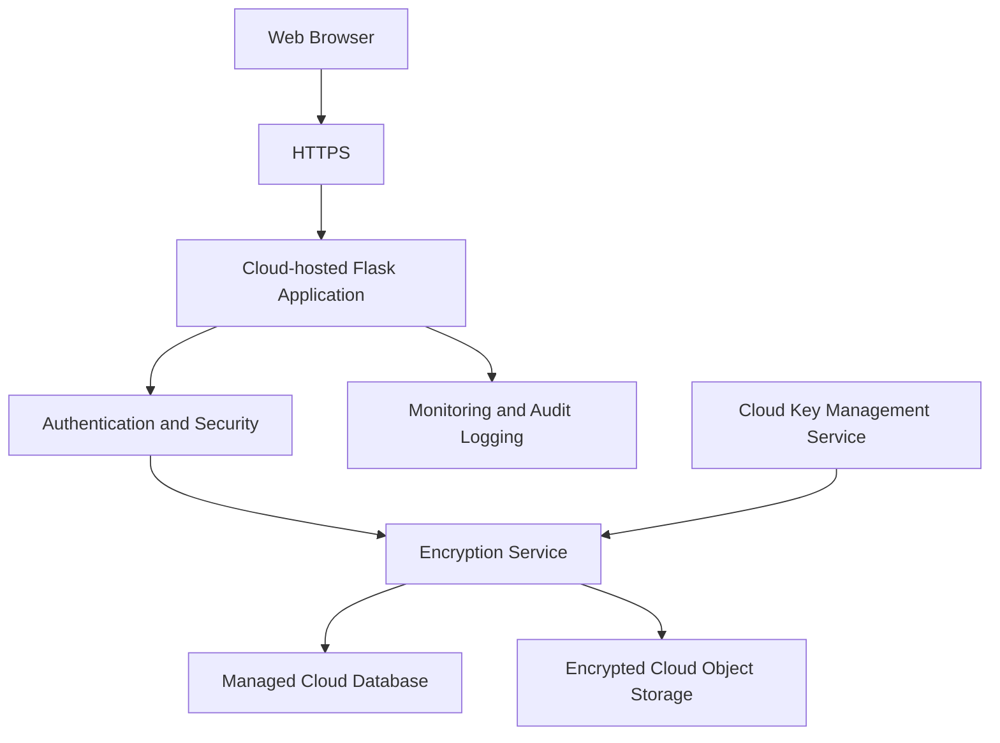

# 🔐 Secure Cloud Data Vault
### A Security-Focused Data Storage, Encryption & Secure Sharing System

<p align="center">
  <strong>CodeAlpha Cloud Computing Internship — Task 2</strong>
</p>

<p align="center">
  
  
  
  
  
  
</p>

---

## 📌 Project Overview

**Secure Cloud Data Vault** is a security-focused data storage and sharing application developed using Python and Flask.

The project demonstrates how sensitive information can be stored securely, protected through modern cryptographic techniques, and shared with authorized recipients using temporary access links.

The system focuses on confidentiality, integrity, authentication, access control, and secure data handling.

Instead of storing sensitive information in readable form, the application encrypts records before saving them to the database. Passwords are protected using Argon2, database operations use parameterized SQL queries, and temporary sharing links are protected using cryptographically secure tokens.

The project was developed as part of the **CodeAlpha Cloud Computing Internship** to gain practical experience in secure application architecture and cloud-security concepts.

## 🎯 Project Objectives

- Design a secure data storage application.
- Protect sensitive information using authenticated encryption.
- Implement secure user registration and authentication.
- Prevent common SQL injection attacks.
- Enforce user-level access control.
- Implement temporary and controlled record sharing.
- Protect application requests against CSRF attacks.
- Validate the security mechanisms through practical testing.

## 🏗️ System Architecture

The application follows a modular architecture that separates the web interface, application logic, security mechanisms, and database operations.



### Architecture Components

| Component | Responsibility |
|---|---|
| Flask Application | Handles routes, requests, and application workflow |
| Authentication Layer | Manages registration, login, and sessions |
| Security Module | Implements password hashing and verification |
| Encryption Module | Encrypts and decrypts sensitive records |
| Database Layer | Stores users, encrypted records, and sharing capabilities |
| Sharing System | Generates and validates temporary sharing links |
| HTML Templates | Provides the registration, login, dashboard, and sharing interface |

## 🔄 Application Workflow

### 1. User Registration
A user creates an account using a username and password. The password is hashed with Argon2 before being stored.

### 2. Secure Authentication
During login, the application retrieves the account using a parameterized database query and verifies the submitted password against the stored Argon2 hash.

### 3. Sensitive Data Storage
The authenticated user submits a record containing a label and sensitive content.

### 4. Data Encryption
The encryption module uses AES-256-GCM to encrypt the record. A unique 12-byte nonce is generated for each encryption operation.

### 5. Encrypted Database Storage
The database stores the encrypted ciphertext and nonce rather than the original plaintext record.

### 6. Secure Data Retrieval
When the owner accesses the dashboard, the application retrieves only records belonging to that user and decrypts them using the appropriate authentication context.

### 7. Temporary Secure Sharing
The owner can generate a temporary sharing link for an individual record. A cryptographically secure random token is generated, while only its SHA-256 hash is stored in the database.

### 8. Recipient Verification
The recipient can access the shared record through the generated link without creating an account. The application checks the token's validity and expiry before allowing access.

### 9. Automatic Expiration
Sharing links expire after 15 minutes. Invalid and expired tokens are rejected.

## 🛡️ Security Implementation

### 1. AES-256-GCM Authenticated Encryption

The system uses AES-256-GCM to protect sensitive records.

Security benefits:

- 256-bit encryption key.
- Authenticated encryption.
- Confidentiality of stored records.
- Integrity verification.
- Detection of unauthorized ciphertext modification.
- Unique 12-byte nonce for each encryption operation.

### 2. Argon2 Password Hashing

Passwords are protected using Argon2, a modern password-hashing algorithm.

Configured parameters:

- Time cost: 3
- Memory cost: 65,536 KiB
- Parallelism: 2

Passwords are never intentionally stored as plaintext.

### 3. SQL Injection Prevention

Database queries use parameterized SQL statements rather than directly inserting user input into SQL commands.

This helps prevent malicious input from changing the intended database query.

### 4. Authentication & Authorization

The application uses session-based authentication and owner-level record filtering.

Users cannot access another user's records through the normal dashboard or sharing endpoint.

### 5. Secure Sharing Tokens

The sharing system uses:

- Cryptographically secure random token generation.
- SHA-256 token hashing before database storage.
- Record ownership verification.
- Expiration timestamps.
- Rejection of invalid and expired tokens.

### 6. CSRF Protection

POST requests are protected using session-based CSRF tokens and constant-time token comparison.

### 7. Environment Variable Protection

Sensitive configuration values are stored in a local `.env` file.

The `.gitignore` configuration excludes:

- `.env`
- Database files
- Virtual environments
- Python cache files

Encryption keys and application secrets must never be committed to a public repository.

## 🧰 Technology Stack

| Technology | Purpose |
|---|---|
| Python | Core programming language |
| Flask | Backend web framework |
| SQLite | Relational database |
| Cryptography | AES-GCM encryption |
| Argon2-cffi | Secure password hashing |
| Python-dotenv | Environment configuration |
| HTML5 | Web interface structure |
| CSS3 | Interface styling |
| Kali Linux | Development and security testing environment |
| Git & GitHub | Version control and project hosting |

## 📂 Project Structure

```text
Secure-Cloud-Data-Vault/
│
├── app.py
│   └── Main Flask application and routes
│
├── database.py
│   └── Database initialization and operations
│
├── encryption.py
│   └── AES-256-GCM encryption and decryption
│
├── security.py
│   └── Argon2 password hashing and verification
│
├── requirements.txt
│   └── Python dependencies
│
├── .gitignore
│   └── Excludes sensitive and unnecessary files
│
├── templates/
│   ├── dashboard.html
│   ├── login.html
│   ├── register.html
│   ├── share_created.html
│   └── shared_record.html
│
├── static/
│   └── Static frontend assets
│
└── README.md
```

## ⚙️ Installation & Setup

### Prerequisites

- Python 3.10 or newer recommended.
- Git.
- Linux, macOS, or Windows.
- Terminal access.

### Step 1: Clone the Repository

```bash
git clone https://github.com/rashidabdullah5737-ai/Secure-Cloud-Data-Vault.git

cd Secure-Cloud-Data-Vault
```

### Step 2: Create a Virtual Environment

```bash
python -m venv venv
```

Activate it on Linux or macOS:

```bash
source venv/bin/activate
```

### Step 3: Install Dependencies

```bash
pip install -r requirements.txt
```

### Step 4: Configure Environment Variables

Create a `.env` file:

```bash
nano .env
```

Generate an encryption key:

```bash
python -c "import os,base64; print(base64.urlsafe_b64encode(os.urandom(32)).decode())"
```

Generate an independent Flask secret:

```bash
python -c "import secrets; print(secrets.token_hex(32))"
```

Add the generated values to `.env`:

```env
ENCRYPTION_KEY=YOUR_GENERATED_ENCRYPTION_KEY
FLASK_SECRET_KEY=YOUR_GENERATED_FLASK_SECRET
```

Keep this file private. Never upload it to GitHub.

**Important:** Back up your encryption key securely. If it is lost, existing encrypted records may become unrecoverable.

### Step 5: Start the Application

```bash
python app.py
```

Open the application in your browser:

```text
http://127.0.0.1:5000
```

Register an account, log in, and start securely storing and sharing records.

## 🧪 Security Testing & Validation

The application was tested using Flask's test client and direct database verification.

| Test | Expected Security Behaviour | Result |
|---|---|---|
| Encrypted database storage | Sensitive content stored as ciphertext | PASS |
| AES-GCM integrity | Tampered ciphertext rejected | PASS |
| Argon2 verification | Correct and incorrect passwords distinguished | PASS |
| SQL injection test | Login bypass prevented | PASS |
| Secure sharing | Valid token grants recipient access | PASS |
| Ownership enforcement | Unauthorized sharing rejected | PASS |
| Token expiration | Expired link returns HTTP 404 | PASS |

### SQL Injection Test

Test payload:

```text
' OR '1'='1' --
```

Observed result:

```text
HTTP Response: 200
Login Bypass Prevented: True
Authentication Granted: False
SQL Injection Test: PASS
```

### Unauthorized Sharing Test

Observed result:

```text
HTTP Response: 404
Unauthorized Sharing Blocked: True
Security Test: PASS
```

### Expired Token Test

Observed result:

```text
Expired link HTTP status: 404
Expired link rejected: True
Security Test: PASS
```

These results demonstrate the tested security controls in the local development environment. They are not a substitute for an independent security audit.

## ☁️ Cloud Computing Relevance

This project demonstrates important concepts relevant to secure cloud application development:

- Secure data storage.
- Data confidentiality and integrity.
- Authentication and authorization.
- Cryptographic key management concepts.
- Controlled data sharing.
- Application-layer security.
- Secure database access.
- Environment-based configuration.

### Future Cloud Deployment Architecture

The next development stage could extend this application to a cloud environment:



Potential future integrations:

- AWS EC2 or Azure App Service for application hosting.
- AWS RDS or managed database services.
- Amazon S3 or Azure Blob Storage for encrypted files.
- AWS KMS or Azure Key Vault for managed encryption keys.
- HTTPS and reverse-proxy configuration.
- Monitoring, audit logging, and rate limiting.
- Automated backups and recovery.

**These are proposed enhancements, not currently implemented integrations.**

## 🚀 Future Improvements

- Deploy the application to AWS or Azure.
- Integrate managed cloud storage.
- Implement cloud key management.
- Add multi-factor authentication.
- Add account recovery and password reset.
- Implement sharing-link revocation.
- Add API rate limiting.
- Implement audit logs and security monitoring.
- Add automated unit and integration tests.
- Use a production-grade WSGI server and HTTPS.
- Add automated backup and recovery procedures.

## 📚 Learning Outcomes

Through this project, I gained practical experience in:

- Python-based secure web application development.
- Flask application architecture.
- AES-256-GCM authenticated encryption.
- Argon2 password hashing.
- SQL injection prevention.
- Session and CSRF protection.
- Database access control.
- Secure token generation and expiration.
- Practical security testing.
- Git and GitHub project management.
- Cloud application security concepts.

## 👨‍💻 Developer

**Abdullah Rashid**

Cybersecurity | Vulnerability Assessment & Penetration Testing | Cloud Security

- GitHub: https://github.com/rashidabdullah5737-ai
- LinkedIn: https://www.linkedin.com/in/abdullah-rashid-a1554b388
- Portfolio: https://rashidabdullah5737-ai.github.io

## 🎓 Internship Project

**Program:** CodeAlpha Cloud Computing Internship  
**Project:** Task 2 — Secure Cloud Data Vault  
**Development Environment:** Kali Linux  
**Project Status:** Local implementation and security testing completed; cloud deployment planned.

---

<p align="center">
  <strong>Built with Python, Flask, and Security in Mind.</strong>
</p>

<p align="center">
  <em>Educational project demonstrating secure data storage and controlled sharing.</em>
</p>
